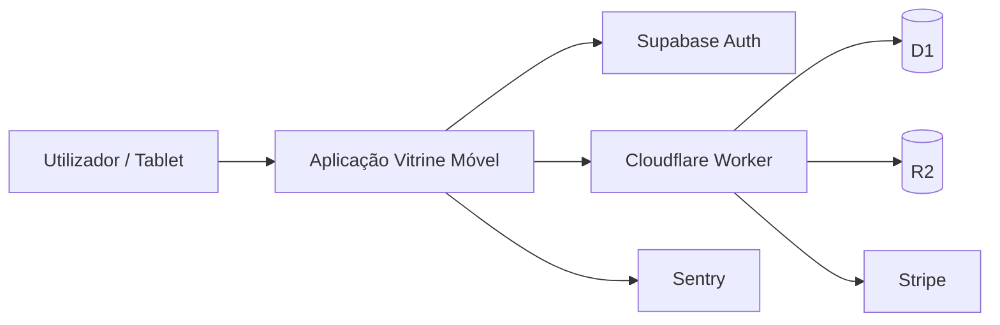

# Vitrine Móvel

Portefólio público do **Vitrine Móvel**, uma plataforma de publicidade digital pensada para gerir clientes, campanhas e a exibição de conteúdos em tablets.

> Este repositório é apenas de apresentação. O código-fonte principal permanece privado por conter lógica de produto, integrações e configuração de infraestrutura.

## Sobre o projeto

O Vitrine Móvel nasceu da ideia de transformar tablets em pontos de divulgação digital geridos de forma centralizada.

A plataforma foi pensada para permitir que motoristas/operadores cadastrem clientes e campanhas, enviem imagens ou vídeos, iniciem sessões de divulgação e acompanhem informações relacionadas com planos, acesso e utilização.

Além da experiência do utilizador, o projeto envolve autenticação, pagamentos por subscrição, controlo de acesso, armazenamento de media, infraestrutura cloud, monitorização e preparação para distribuição como aplicação.

## O que trabalhei no projeto

- Autenticação e gestão de utilizadores
- Perfis e regras de acesso
- Gestão de clientes e campanhas
- Upload e apresentação de imagens e vídeos
- Planos de subscrição e integração com Stripe
- Validação de webhooks e idempotência em pagamentos
- Integração com Supabase
- Infraestrutura com Cloudflare Workers, D1 e R2
- Monitorização de erros com Sentry
- Regras de sessão e utilização em tablets
- Estrutura para suporte ao utilizador
- Preparação do produto para publicação futura em Google Play e Apple App Store

## Tecnologias

- **Supabase** — autenticação e serviços de backend
- **Stripe** — subscrições e pagamentos
- **Cloudflare Workers** — backend/edge runtime
- **Cloudflare D1** — base de dados
- **Cloudflare R2** — armazenamento de ficheiros/media
- **Sentry** — monitorização e observabilidade
- **Git / GitHub** — versionamento e gestão do projeto

## Arquitetura simplificada

## Estado do projeto

Projeto em desenvolvimento ativo.

Entre os pontos já trabalhados estão autenticação, onboarding, regras de sessão, integração Stripe, webhook, idempotência, integração Supabase, infraestrutura Cloudflare e monitorização com Sentry.

Ainda fazem parte do roadmap funcionalidades como recuperação de palavra-passe, gestão completa de plano e pagamento, relatórios, suporte ao utilizador, reforço de segurança, Google Login/MFA e preparação final para publicação nas lojas.

## Screenshots

A pasta [`screenshots/`](screenshots/) será usada para mostrar o produto sem expor dados sensíveis.

## Repositório privado

O repositório de desenvolvimento permanece privado por motivos de segurança e proteção do produto.

## Autor

**Hasan Marouf**  
Web Developer Júnior — Coimbra, Portugal
